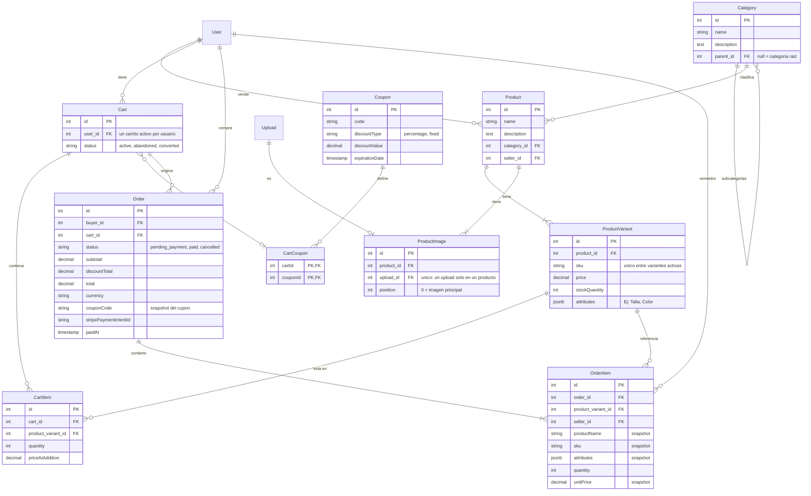

# NestJS App Template

> Backend modular para construir APIs seguras con NestJS, PostgreSQL y TypeORM, ahora con un marketplace completo: los usuarios publican y venden productos, compran con carrito y pagan con Stripe.

Una base de proyecto pensada para equipos que necesitan arrancar rapido sin sacrificar estructura: autenticacion JWT, autorizacion por permisos, CRUD modular, subida de archivos a Cloudinary, validacion global, jobs programados, circuit breakers y seeders idempotentes al iniciar la aplicacion. Sobre esa base se agrega un **ecommerce** con catalogo, categorias, carrito, cupones, pedidos, pagos con Stripe e idempotencia con Redis.

## Por que este template

- **Modular por dominio:** cada bounded context mantiene controladores, servicios, DTOs, entidades y seeders cerca de su responsabilidad.
- **Seguro por defecto:** `JwtAuthGuard` es global; las rutas publicas se declaran de forma explicita con `@Public()`.
- **Autorizacion extensible:** los permisos se expresan con `@PreAuthorized()` y se evaluan mediante `PermissionsGuard`.
- **Persistencia pragmatica:** TypeORM + PostgreSQL, entidades cargadas automaticamente y soft delete en la entidad base.
- **Resiliente a fallos externos:** las llamadas a servicios externos (Cloudinary, Stripe) pasan por circuit breakers (`opossum`) con estado consultable en `/health/circuit-breakers`.
- **Pagos seguros:** Stripe con webhook firmado, stock reservado en el checkout y reembolso automatico si un pago llega tarde.
- **Operaciones idempotentes:** el checkout acepta reintentos sin duplicar pedidos (Redis) y los eventos de Stripe se deduplican.
- **Jobs programados sin acoplarse a una libreria:** wrapper propio sobre `node-cron` (`Scheduler`/`CronJob`) para correr tareas periodicas de forma consistente.
- **Operable desde el primer arranque:** roles, permisos y usuario `SUPER_ADMIN` se inicializan de forma idempotente.
- **Listo para contenedores:** imagen multi-stage basada en Node 22 Alpine.

## Stack

| Capa | Tecnologia |
| --- | --- |
| Runtime | Node.js 22, TypeScript |
| Framework | NestJS 11 |
| API | Express, Swagger |
| Datos | PostgreSQL, TypeORM 0.3 |
| Cache / idempotencia | Redis (`ioredis`) |
| Pagos | Stripe (`stripe`) |
| Seguridad | JWT, Passport, bcrypt |
| Archivos | Cloudinary, Multer |
| Resiliencia | opossum (circuit breaker) |
| Jobs programados | node-cron |
| Validacion | class-validator, class-transformer |
| Calidad | Jest, ESLint, Prettier |
| Package manager | pnpm |

## Requisitos

- Node.js 22 o superior
- pnpm habilitado mediante Corepack
- PostgreSQL accesible desde la aplicacion
- Redis accesible desde la aplicacion (obligatorio: lo usa la idempotencia)
- Credenciales de Cloudinary (subida de imagenes de productos)
- Cuenta de Stripe (modo test para desarrollo) y [Stripe CLI](https://docs.stripe.com/stripe-cli) para probar el webhook en local

Habilita pnpm si tu instalacion aun no lo tiene:

```bash
corepack enable
```

## Inicio local

1. Instala dependencias:

   ```bash
   pnpm install
   ```

2. Levanta PostgreSQL y Redis (ver [Redis y PostgreSQL con Docker](#redis-y-postgresql-con-docker)).

3. Crea `.env` en la raiz. Como minimo:

   ```env
   NODE_ENV=develop
   PORT=3000

   DB_HOST=localhost
   DB_PORT=5432
   DB_USER=postgres
   DB_PASSWORD=change-me
   DB_NAME=nestjs

   JWT_SECRET=change-me-with-a-long-random-value

   CLOUDINARY_CLOUD_NAME=your-cloud-name
   CLOUDINARY_API_KEY=your-api-key
   CLOUDINARY_API_SECRET=your-api-secret

   SUPER_ADMIN_EMAIL=admin@example.com
   SUPER_ADMIN_PASSWORD=change-me
   SUPER_ADMIN_USERNAME=admin

   REDIS_HOST=localhost
   REDIS_PORT=6379
   REDIS_PASSWORD=change-me

   STRIPE_SECRET_KEY=sk_test_...
   STRIPE_WEBHOOK_SECRET=whsec_...
   STRIPE_CURRENCY=usd
   ```

   El circuit breaker, los jobs (uploads huerfanos y expiracion de pedidos) y la idempotencia tienen defaults sensatos y no requieren variables extra para arrancar. Si queres ajustarlos, mira la tabla de [Configuracion](#configuracion).

4. Inicia el servidor en modo desarrollo:

   ```bash
   pnpm start:dev
   ```

La API queda disponible en `http://localhost:3000/api`.

Cuando `NODE_ENV=develop`, Swagger se publica en `http://localhost:3000/docs`.

## Docker

El `docker-compose.yaml` levanta solamente la API y espera una red Docker externa llamada `postgres_network`.

```bash
docker network create postgres_network
docker compose up -d --build
```

El contenedor recibe las variables desde `.env`. Para usar PostgreSQL en otro contenedor, conectalo tambien a `postgres_network` y usa como `DB_HOST` el nombre del servicio, no `localhost`. Lo mismo aplica a Redis: si corre en otro contenedor, usa su nombre como `REDIS_HOST`.

La imagen ejecuta esta secuencia durante el build:

```text
pnpm install --frozen-lockfile -> pnpm test -> pnpm build -> pnpm prune --prod
```

### Redis y PostgreSQL con Docker

Cada servicio tiene su propio `docker-compose.yml` (en carpetas separadas) y lee su configuracion de un `.env` junto al archivo.

**Redis**

```yaml
services:
  redis:
    image: redis:7-alpine
    container_name: redis-cache
    restart: unless-stopped
    command:
      [
        "redis-server",
        "--appendonly",
        "yes",
        "--requirepass",
        "${REDIS_PASSWORD}",
      ]
    ports:
      - "6379:6379"
    volumes:
      - redis-data:/data
    networks:
      - network
    healthcheck:
      test: ["CMD", "redis-cli", "-a", "${REDIS_PASSWORD}", "ping"]
      interval: 10s
      timeout: 3s
      retries: 5

networks:
  network:
    driver: bridge

volumes:
  redis-data:
```

`--appendonly yes` persiste los datos para que las claves de idempotencia y los eventos de webhook ya procesados no se pierdan al reiniciar. `REDIS_PASSWORD` debe coincidir con la que usa la API; si no esta definida, Redis arranca con contrasena vacia y el healthcheck falla.

**PostgreSQL**

```yaml
services:
  postgres:
    image: postgres:latest
    container_name: some-postgres

    ports:
      - "5432:5432"

    environment:
      POSTGRES_USER: ${POSTGRES_USER:-postgres}
      POSTGRES_PASSWORD: ${POSTGRES_PASSWORD:-change_me}
      POSTGRES_DB: ${POSTGRES_DB:-app_db}

    volumes:
      - data:/var/lib/postgresql
      - ./sql:/docker-entrypoint-initdb.d:ro

    networks:
      - network

    restart: unless-stopped

    healthcheck:
      test: ["CMD-SHELL", "pg_isready -U $${POSTGRES_USER} -d $${POSTGRES_DB}"]
      interval: 10s
      timeout: 5s
      retries: 5

    logging:
      driver: "json-file"
      options:
        max-size: "10m"
        max-file: "3"

networks:
  network:
    driver: bridge

volumes:
  data:
```

Los scripts `.sql` de `./sql` se ejecutan solo la primera vez, cuando el volumen esta vacio.

> **Ojo con los nombres de variables.** Postgres lee `POSTGRES_USER`, `POSTGRES_PASSWORD` y `POSTGRES_DB`, mientras que la API lee `DB_USER`, `DB_PASSWORD` y `DB_NAME`. Deben tener los mismos valores; si no defines las de `POSTGRES_*`, el contenedor usa los defaults (`postgres` / `change_me` / `app_db`) y la API no podra conectarse.

```env
POSTGRES_USER=postgres
POSTGRES_PASSWORD=change-me
POSTGRES_DB=nestjs
```

Si la API corre en Docker, conecta estos contenedores a `postgres_network` para que se vean entre si y usa sus nombres (`some-postgres`, `redis-cache`) como `DB_HOST` y `REDIS_HOST`:

```bash
docker network connect postgres_network some-postgres
docker network connect postgres_network redis-cache
```

En produccion no publiques los puertos 5432 ni 6379 a internet.

## Configuracion

| Variable | Uso |
| --- | --- |
| `NODE_ENV` | `develop` habilita Swagger; `production` desactiva `synchronize`, activa SSL de PostgreSQL y exige `https://` en `CORS_ORIGINS`. |
| `PORT` | Puerto HTTP de la API. |
| `DB_HOST`, `DB_PORT`, `DB_USER`, `DB_PASSWORD`, `DB_NAME` | Conexion PostgreSQL. |
| `DB_POOL_MAX`, `DB_POOL_MIN` | Limites del pool de conexiones. |
| `DB_POOL_ACQUIRE_TIMEOUT`, `DB_POOL_IDLE_TIMEOUT` | Timeouts del pool en milisegundos. |
| `JWT_SECRET` | Secreto utilizado para firmar tokens. La app no arranca si falta. |
| `CORS_ORIGINS` | Origenes permitidos separados por comas (sin path, query ni credenciales). |
| `CLOUDINARY_CLOUD_NAME`, `CLOUDINARY_API_KEY`, `CLOUDINARY_API_SECRET` | Conexion con Cloudinary. |
| `SUPER_ADMIN_EMAIL`, `SUPER_ADMIN_PASSWORD`, `SUPER_ADMIN_USERNAME` | Credenciales del usuario inicial. |
| `REDIS_URL` | URL de conexion a Redis. Si se define, tiene prioridad sobre las siguientes. |
| `REDIS_HOST`, `REDIS_PORT`, `REDIS_PASSWORD`, `REDIS_DB` | Conexion a Redis por separado. Defaults: `localhost`, `6379`, sin password, `0`. |
| `IDEMPOTENCY_TTL_SECONDS` | Cuanto se guarda la respuesta de una operacion idempotente. Default `86400` (24 h). |
| `IDEMPOTENCY_LOCK_TTL_SECONDS` | Duracion del bloqueo mientras la peticion esta en curso. Default `60`. |
| `WEBHOOK_EVENT_TTL_SECONDS` | Cuanto se recuerdan los eventos de Stripe ya procesados. Default `604800` (7 dias). |
| `STRIPE_SECRET_KEY` | Clave secreta de Stripe (`sk_test_...` en desarrollo). Sin ella los pagos no estan disponibles. |
| `STRIPE_WEBHOOK_SECRET` | Secreto de firma del webhook (`whsec_...`). |
| `STRIPE_CURRENCY` | Moneda de los pedidos. Default `usd`. |
| `ORDER_PAYMENT_TTL_MINUTES` | Tiempo para pagar un pedido antes de que expire y se devuelva el stock. Default `30`. |
| `PENDING_ORDERS_EXPIRATION_CRON` | Expresion cron del job que expira pedidos sin pagar. Default `*/5 * * * *`. |
| `CB_TIMEOUT_MS` | Timeout (ms) antes de que un circuit breaker de por fallida una llamada. Default `8000`. |
| `CB_ERROR_THRESHOLD_PERCENTAGE` | % de fallos que abre el circuito. Default `50`. |
| `CB_RESET_TIMEOUT_MS` | Tiempo (ms) que el circuito permanece abierto antes de pasar a half-open. Default `15000`. |
| `CB_VOLUME_THRESHOLD` | Minimo de llamadas en la ventana antes de evaluar el % de error. Default `5`. |
| `ORPHAN_UPLOADS_CLEANUP_CRON` | Expresion cron del job que borra uploads huerfanos. Default `*/15 * * * *`. |
| `ORPHAN_UPLOADS_MIN_AGE_MINUTES` | Antiguedad minima (minutos) para considerar un upload huerfano. Default `30`. |

No guardes secretos reales en el repositorio. Usa un gestor de secretos en CI/CD y genera un `JWT_SECRET` aleatorio y largo para cada entorno.

## Inicializacion de datos

Los seeders se ejecutan durante `onApplicationBootstrap`:

1. `PermissionsSeeder` registra los permisos definidos en `src/common/constants/permissions.ts`.
2. `RolesSeeder` registra `SUPER_ADMIN` y `ADMIN` mediante `upsert`.
3. `UserRoleSeeder` garantiza el rol `USER` (el que reciben los usuarios al registrarse) y le asigna el permiso `CREATE_UPLOAD`, necesario para subir las imagenes de sus productos. No depende del orden de `PermissionsSeeder`: crea los permisos que necesita si aun no existen.
4. `SuperAdminSeeder` espera explicitamente a `RolesSeeder`, verifica si ya existe un usuario con rol `SUPER_ADMIN` y, si no existe, crea el usuario configurado en `.env` con la contrasena hasheada mediante bcrypt.

El proceso es idempotente. Si ya existe un super-admin, un usuario con el mismo email o username, o faltan las variables del super-admin, el seeder no sobrescribe datos existentes.

> En produccion `synchronize` esta desactivado. Usa migraciones gestionadas para evolucionar el esquema: las tablas del ecommerce (productos, pedidos, etc.) no se crean solas.

## Ecommerce

### Modelo de datos

Los identificadores son numericos (`BaseEntity` con autoincremento), igual que el resto del proyecto. Todas las entidades heredan `createdAt`, `updatedAt` y `deletedAt` (soft delete).



Los pedidos guardan un **snapshot** del nombre, sku, atributos y precio de cada item. Si el producto cambia o se elimina despues, el historial del pedido no se altera.

### Relaciones en los payloads

Al crear o actualizar, los atributos de tipo relacion se envian como `{ id: number }` (relacion simple) o `[{ id: number }]` (lista). Nunca como un id suelto.

```json
{
  "name": "Camiseta basica",
  "description": "100% algodon",
  "category": { "id": 3 },
  "images": [{ "id": 10 }, { "id": 11 }],
  "variants": [
    {
      "sku": "CAM-BAS-M-ROJO",
      "price": 19.99,
      "stockQuantity": 25,
      "attributes": { "Talla": "M", "Color": "Rojo" }
    }
  ]
}
```

El orden de `images` define la posicion: la primera es la imagen principal. `attributes` de una variante es un objeto plano (valores `string`, `number` o `boolean`).

### Productos

Cualquier usuario autenticado puede publicar productos y gestionar **solo los suyos**. Un usuario con el permiso `MANAGE_PRODUCTS` (o `SUPER_ADMIN`) puede moderar los de cualquiera.

| Metodo | Ruta | Acceso |
| --- | --- | --- |
| `GET` | `/products` | Publico (catalogo, nunca incluye eliminados) |
| `GET` | `/products/:id` | Publico |
| `GET` | `/products/mine` | JWT (mis productos como vendedor; `deleted=true` lista los eliminados) |
| `POST` | `/products` | JWT |
| `PUT` | `/products/:id` | Vendedor o moderador |
| `DELETE` | `/products/:id` | Vendedor o moderador (soft delete) |
| `PATCH` | `/products/:id/restore` | Vendedor o moderador |
| `POST` | `/products/:id/variants` | Vendedor o moderador |
| `PUT` | `/products/:id/variants/:variantId` | Vendedor o moderador |
| `DELETE` | `/products/:id/variants/:variantId` | Vendedor o moderador |

El catalogo soporta paginacion, busqueda por nombre y descripcion, ordenamiento (`sort=price,asc`) y estos filtros:

- `category`: incluye los productos de sus subcategorias.
- `seller`: filtra por vendedor.

Reglas:

- Un producto necesita entre 1 y 10 imagenes y entre 1 y 50 variantes.
- Las imagenes deben ser `image` (no video ni PDF) y un upload solo puede pertenecer a un producto.
- El `sku` es unico entre variantes activas y no se puede repetir dentro del mismo payload.
- Un producto siempre conserva al menos una variante.
- `PUT /products/:id` no modifica variantes; se gestionan en `/products/:id/variants`.
- Al actualizar `images`, las imagenes que ya no estan en la lista se borran de Cloudinary y de la base de datos.
- Al eliminar un producto o una variante, desaparecen de los carritos activos.

**Flujo para publicar un producto:** subir las imagenes con `POST /uploads/many` (devuelve sus `id`) y despues `POST /products` referenciandolas como `[{ "id": n }]`. Las imagenes que no se asignan a ningun producto o usuario se borran como huerfanos pasado `ORPHAN_UPLOADS_MIN_AGE_MINUTES`.

### Categorias y subcategorias

Hay exactamente dos niveles: una categoria raiz y sus subcategorias. Una subcategoria se crea enviando `parent`.

| Metodo | Ruta | Acceso |
| --- | --- | --- |
| `GET` | `/categories` | Publico (filtros `parent`, `root`) |
| `GET` | `/categories/tree` | Publico (arbol completo) |
| `GET` | `/categories/:id` | Publico |
| `POST` | `/categories` | `CREATE_CATEGORY` |
| `PUT` | `/categories/:id` | `UPDATE_CATEGORY` |
| `DELETE` | `/categories/:id` | `DELETE_CATEGORY` |
| `PATCH` | `/categories/:id/restore` | `RESTORE_CATEGORY` |

```json
{ "name": "Camisetas", "parent": { "id": 1 } }
```

Reglas: el nombre es unico dentro del mismo nivel; una categoria no puede ser su propio padre; una categoria con subcategorias no puede convertirse en subcategoria; y no se puede eliminar una categoria que tenga subcategorias o productos.

### Carrito

Todas las rutas requieren JWT y operan sobre el carrito activo del usuario (se crea al primer uso). Cada usuario tiene un unico carrito activo.

| Metodo | Ruta | Descripcion |
| --- | --- | --- |
| `GET` | `/cart` | Ver el carrito con totales |
| `DELETE` | `/cart` | Vaciar el carrito |
| `POST` | `/cart/items` | Agregar una variante: `{ "productVariant": { "id": 5 }, "quantity": 2 }` |
| `PATCH` | `/cart/items/:itemId` | Cambiar la cantidad: `{ "quantity": 3 }` |
| `DELETE` | `/cart/items/:itemId` | Quitar un item |
| `POST` | `/cart/coupon` | Aplicar un cupon: `{ "code": "VERANO10" }` |
| `DELETE` | `/cart/coupon` | Quitar el cupon |

Reglas:

- **Un usuario no puede comprar sus propios productos.** Se valida al agregar al carrito y de nuevo en el checkout (403).
- Maximo 99 unidades por producto y nunca mas que el stock disponible.
- Cada item guarda `priceAtAddition`. Si el precio de la variante cambia antes de pagar, el checkout lo detecta (ver abajo).
- Solo hay un cupon por carrito; aplicar otro reemplaza al anterior.
- Aunque la columna `user_id` del carrito admite `null` para carritos anonimos, la API actual requiere usuario autenticado.

### Cupones

La gestion es de administracion; los compradores solo los aplican por codigo en su carrito.

| Metodo | Ruta | Acceso |
| --- | --- | --- |
| `GET` | `/coupons` | `READ_COUPON` |
| `GET` | `/coupons/:id` | `READ_COUPON` |
| `POST` | `/coupons` | `CREATE_COUPON` |
| `PUT` | `/coupons/:id` | `UPDATE_COUPON` |
| `DELETE` | `/coupons/:id` | `DELETE_COUPON` |
| `PATCH` | `/coupons/:id/restore` | `RESTORE_COUPON` |

```json
{
  "code": "VERANO10",
  "discountType": "percentage",
  "discountValue": 10,
  "expirationDate": "2026-12-31T23:59:59.000Z"
}
```

`discountType` es `percentage` (maximo 100) o `fixed` (monto en la moneda del pedido). El codigo se normaliza a mayusculas y es unico. La fecha de expiracion debe ser futura al crearlo. El descuento nunca supera el subtotal, y los calculos se hacen en centavos para evitar errores de redondeo.

### Pedidos y checkout

| Metodo | Ruta | Descripcion |
| --- | --- | --- |
| `POST` | `/orders/checkout` | Crea el pedido y el pago (**requiere `Idempotency-Key`**) |
| `GET` | `/orders` | Mis compras (filtro `status`) |
| `GET` | `/orders/:id` | Detalle de una compra propia |
| `POST` | `/orders/:id/cancel` | Cancelar un pedido pendiente de pago |
| `GET` | `/orders/sales` | Lo que he vendido: items de pedidos ya pagados |

Estados de un pedido:

```text
pending_payment ──(webhook succeeded)──▶ paid
       │
       └──(cancelacion, expiracion o Stripe cancela)──▶ cancelled
```

**Que hace `POST /orders/checkout`:**

1. Valida el carrito: que no este vacio, que ningun producto sea del comprador, que los precios no hayan cambiado y que el cupon siga vigente.
2. En una sola transaccion marca el carrito como `converted`, descuenta el stock de forma atomica y crea el pedido en `pending_payment`.
3. Crea el `PaymentIntent` en Stripe y devuelve `{ order, clientSecret }`. Si Stripe falla, revierte todo: libera el stock y reactiva el carrito.
4. El front confirma el pago con Stripe.js usando `clientSecret`. Si el total es 0 (cupon del 100%), el pedido pasa directo a `paid` y `clientSecret` es `null`.

Errores frecuentes del checkout:

| Codigo | Motivo |
| --- | --- |
| 400 | Carrito vacio |
| 403 | El carrito contiene un producto propio |
| 409 | El precio de algun producto cambio (el carrito se actualiza; hay que revisarlo y reintentar), stock insuficiente, cupon vencido o carrito ya procesado |
| 502 | No se pudo iniciar el pago en Stripe |

**Cancelacion y expiracion.** El comprador solo puede cancelar pedidos en `pending_payment`; se cancela el pago en Stripe, se devuelve el stock y se reactiva el carrito (si no creo otro activo mientras tanto). Un job (`PendingOrdersExpirationJob`) cancela de la misma forma los pedidos que superan `ORDER_PAYMENT_TTL_MINUTES` sin pagarse.

## Pagos con Stripe

El pago se confirma de forma asincrona mediante el webhook; **la respuesta del front nunca marca un pedido como pagado**.

| Metodo | Ruta | Acceso |
| --- | --- | --- |
| `POST` | `/payments/stripe/webhook` | Publico (autenticado por firma de Stripe) |

Eventos procesados:

| Evento | Efecto |
| --- | --- |
| `payment_intent.succeeded` | Pasa el pedido a `paid`. Si el pedido ya estaba cancelado (el pago llego tarde), reembolsa automaticamente. |
| `payment_intent.canceled` | Cancela el pedido y devuelve el stock. |
| `payment_intent.payment_failed` | Solo se registra en el log: no es terminal, el cliente puede reintentar con otra tarjeta. |

Garantias:

- La firma se valida con `STRIPE_WEBHOOK_SECRET` sobre el body crudo (`rawBody` esta habilitado en `main.ts`). Una firma invalida responde 400.
- Antes de marcar un pedido como pagado se verifica que el monto y la moneda coincidan con los del pedido. Si no coinciden, se registra el error para revision manual y no se cambia el estado.
- Si el procesamiento falla, se libera el evento y se responde 5xx para que Stripe reintente.

### Probar el webhook en local

Con la API corriendo, en otra terminal:

```bash
stripe login
stripe listen --events payment_intent.succeeded,payment_intent.canceled,payment_intent.payment_failed --forward-to localhost:3000/api/payments/stripe/webhook
```

El comando imprime un `whsec_...`: ese valor va en `STRIPE_WEBHOOK_SECRET` (reinicia la API despues). Mantene `stripe listen` abierto mientras pruebas. Para un flujo real, crea un pedido con `POST /orders/checkout` y paga con la tarjeta de prueba `4242 4242 4242 4242`. Con `stripe trigger payment_intent.succeeded` verificas que el endpoint responde `200`, pero ese evento no corresponde a ningun pedido tuyo.

El secreto de `stripe listen` y el del dashboard son distintos: usa el del CLI en local y el del dashboard en produccion. La `STRIPE_SECRET_KEY` debe ser del mismo sandbox/cuenta que escucha el CLI.

## Idempotencia

`src/shared/idempotency` permite reintentar operaciones sin duplicar sus efectos. Se apoya en Redis.

Se activa en un endpoint con el decorador `@Idempotent()`, que exige el header `Idempotency-Key`. Hoy lo usa `POST /orders/checkout`:

```http
POST /api/orders/checkout
Authorization: Bearer <token>
Idempotency-Key: 8f14e45f-ceea-4672-a5f1-1c0a2f9d3b7e
```

- La clave debe tener entre 8 y 128 caracteres (`A-Z a-z 0-9 _ . : -`); un UUID v4 funciona bien. Genera una por intencion de compra y reutilizala solo para reintentar esa misma operacion.
- Las claves son **por usuario**: dos usuarios pueden usar la misma sin conflicto.

| Situacion | Respuesta |
| --- | --- |
| Primera peticion | Se ejecuta y se guarda el resultado |
| Misma clave y mismo request, ya completado | Devuelve la respuesta original sin ejecutar de nuevo, con el header `Idempotent-Replayed: true` |
| Misma clave mientras la primera sigue en curso | `409 Conflict` |
| Misma clave con otro metodo, ruta o body | `422 Unprocessable Entity` |
| El handler falla | La clave se libera para permitir reintentos |

El resultado se conserva `IDEMPOTENCY_TTL_SECONDS` (24 h por defecto); el bloqueo mientras se procesa dura `IDEMPOTENCY_LOCK_TTL_SECONDS`.

La idempotencia aparece en tres niveles: el header del cliente (checkout), la `idempotencyKey` que se envia a Stripe al crear el `PaymentIntent` (`order-<id>-payment-intent`), y la deduplicacion por `event.id` de los eventos del webhook.

> Redis es obligatorio. Con `enableOfflineQueue` desactivado, si Redis no esta disponible las operaciones idempotentes fallan rapido en vez de quedarse esperando.

## API principal

Todas las rutas usan el prefijo `/api`. Las rutas del ecommerce estan documentadas en la seccion [Ecommerce](#ecommerce).

### Auth

| Metodo | Ruta | Acceso |
| --- | --- | --- |
| `POST` | `/auth/login` | Publico |
| `POST` | `/auth/signup` | Publico (asigna el rol `USER`) |
| `POST` | `/auth/refresh` | Publico |
| `POST` | `/auth/logout` | Publico |
| `GET` | `/auth/profile` | JWT |
| `PATCH` | `/auth/profile` | JWT |
| `PATCH` | `/auth/profile/password` | JWT |

### Usuarios

| Metodo | Ruta | Acceso |
| --- | --- | --- |
| `GET` | `/users` | Permiso de lectura |
| `GET` | `/users/:id` | Permiso de lectura |
| `POST` | `/users` | Permiso de creacion |
| `PUT` | `/users/:id` | Permiso de actualizacion |
| `DELETE` | `/users/:id` | Permiso de eliminacion |
| `PATCH` | `/users/:id/restore` | Permiso de restauracion |

La lista de usuarios soporta paginacion, busqueda, ordenamiento, filtro por rol, estado bloqueado y registros eliminados.

### Roles y permisos

Los modulos `RoleModule` y `PermissionModule` gestionan el catalogo de roles y permisos. Un usuario `SUPER_ADMIN` supera la comprobacion de permisos; los demas usuarios necesitan que su rol tenga el permiso requerido.

Permisos del ecommerce (definidos en `src/common/constants/permissions.ts`):

| Permiso | Uso |
| --- | --- |
| `CREATE_CATEGORY`, `UPDATE_CATEGORY`, `DELETE_CATEGORY`, `RESTORE_CATEGORY` | Gestion de categorias |
| `READ_COUPON`, `CREATE_COUPON`, `UPDATE_COUPON`, `DELETE_COUPON`, `RESTORE_COUPON` | Gestion de cupones |
| `MANAGE_PRODUCTS` | Moderar productos de cualquier vendedor |
| `CREATE_UPLOAD` | Subir archivos (lo tiene el rol `USER`) |

El rol `USER` solo recibe `CREATE_UPLOAD`. Los permisos de categorias, cupones y moderacion se asignan a `ADMIN` (u otro rol) desde la API de roles; `SUPER_ADMIN` los tiene todos.

### Uploads

| Metodo | Ruta | Descripcion |
| --- | --- | --- |
| `POST` | `/uploads` | Sube un archivo |
| `POST` | `/uploads/many` | Sube varios archivos |
| `GET` | `/uploads` | Lista archivos con paginacion |
| `GET` | `/uploads/:id` | Consulta metadata |
| `DELETE` | `/uploads/:id` | Elimina archivo y metadata |

Los tipos MIME permitidos se centralizan en `src/common/constants/mime-types.ts`.

Un job periodico (`OrphanUploadsCleanupJob`) borra en batch, via el circuit breaker de Cloudinary, los uploads que no estan asociados ni a un usuario (foto de perfil) ni a un producto (imagenes). Ver [Jobs programados](#jobs-programados-node-cron).

### Salud / observabilidad

| Metodo | Ruta | Descripcion |
| --- | --- | --- |
| `GET` | `/health/circuit-breakers` | Estado (`closed`/`open`/`halfOpen`) y estadisticas de cada circuit breaker registrado. Publico. |

## Arquitectura

```text
src/
├── common/          Contratos, decoradores, parsers, helpers, transformers y validadores compartidos
├── filter/          Filtros globales para errores HTTP y TypeORM
├── integrations/    Adaptadores de infraestructura: crypto, Cloudinary, JWT, TypeORM, Redis y Stripe
├── modules/         Dominios de negocio
│   ├── auth/
│   ├── cart/        Carrito, items y calculo de totales
│   ├── category/    Categorias y subcategorias (2 niveles)
│   ├── coupon/      Cupones de descuento
│   ├── health/      Endpoint de estado de los circuit breakers
│   ├── order/       Checkout, pedidos y ventas
│   │   └── jobs/    Expiracion de pedidos sin pagar
│   ├── payment/     Webhook de Stripe
│   ├── permission/
│   ├── product/     Productos, variantes e imagenes
│   ├── refresh_token/
│   ├── role/
│   ├── upload/
│   │   └── jobs/    Jobs de node-cron propios del dominio (ej. limpieza de huerfanos)
│   └── user/
├── security/        Guards y estrategia JWT
├── shared/
│   ├── idempotency/ Interceptor, servicio (Redis) y decorador @Idempotent()
│   ├── resilience/  CircuitBreakerFactory, CircuitBreakerRegistry y helpers de error de opossum
│   └── scheduler/   Wrapper propio sobre node-cron (Scheduler, CronJob, NodeCronScheduler)
├── app.module.ts    Composicion de la aplicacion
└── main.ts          Bootstrap HTTP, CORS, pipes, filtros, rawBody y Swagger
```

### Convenciones de seguridad

- Las contrasenas nunca se persisten en texto plano; `CryptoService` usa bcrypt.
- Los DTOs se validan mediante `ValidationPipe` global con `whitelist` y `forbidNonWhitelisted`.
- Las respuestas de usuario pasan por `UserMapper`, evitando exponer directamente el modelo de persistencia.
- La aplicacion rechaza origenes CORS que no esten en `CORS_ORIGINS`. Los headers permitidos incluyen `Idempotency-Key` y se expone `Idempotent-Replayed`.
- Los endpoints son privados por defecto.
- El webhook de Stripe es publico pero solo acepta peticiones con firma valida.
- Las operaciones sobre un producto verifican que el usuario sea su vendedor (o moderador).

## Jobs programados (node-cron)

`src/shared/scheduler` define un wrapper propio sobre `node-cron` para no acoplar el resto de la app a su API directamente:

- **`scheduler.port.ts`** — contratos `CronJob` (lo que implementa cada job) y `Scheduler` (lo que expone el motor que los corre).
- **`node-cron.scheduler.ts`** (`NodeCronScheduler`) — implementa `Scheduler` usando `node-cron`. Los jobs se `register()`-an durante el `onModuleInit` de su modulo; `NodeCronScheduler` los crea y arranca a todos juntos en `onApplicationBootstrap`, cuando toda la app ya esta inicializada, y los detiene en `onModuleDestroy`.
- **`scheduler.module.ts`** (`SchedulerModule`) — modulo `@Global()` que provee `NodeCronScheduler` para toda la app.

Jobs existentes:

| Job | Ubicacion | Funcion |
| --- | --- | --- |
| `OrphanUploadsCleanupJob` | `src/modules/upload/jobs/` | Borra uploads sin usuario ni producto asociado |
| `PendingOrdersExpirationJob` | `src/modules/order/jobs/` | Cancela pedidos sin pagar tras `ORDER_PAYMENT_TTL_MINUTES` y devuelve el stock |

### Como agregar un nuevo job

1. Crea la clase del job dentro de la carpeta `jobs/` de tu modulo, implementando `CronJob` y registrandose en `onModuleInit`:

   ```typescript
   // src/modules/<tu-modulo>/jobs/mi-job.job.ts
   import { Injectable, Logger, OnModuleInit } from '@nestjs/common';
   import { ConfigService } from '@nestjs/config';
   import { NodeCronScheduler } from 'src/shared/scheduler/node-cron.scheduler';
   import { CronJob } from 'src/shared/scheduler/scheduler.port';

   @Injectable()
   export class MiJob implements CronJob, OnModuleInit {
     private readonly logger = new Logger(MiJob.name);

     readonly name = 'mi-job';
     readonly cronExpression: string;
     readonly preventOverlap = true; // default true; poné false si el job puede solaparse

     constructor(
       private readonly scheduler: NodeCronScheduler,
       config: ConfigService,
     ) {
       this.cronExpression = config.get<string>('MI_JOB_CRON') ?? '0 * * * *';
     }

     onModuleInit(): void {
       this.scheduler.register(this);
     }

     async run(): Promise<void> {
       // logica del job
       this.logger.log('mi-job ejecutado');
     }
   }
   ```

2. Registralo como `provider` en el modulo correspondiente:

   ```typescript
   @Module({
     providers: [MiJob /* ...otros providers */],
   })
   export class TuModulo {}
   ```

3. Si el job usa una expresion cron configurable, documenta la variable en la tabla de [Configuracion](#configuracion) (con su default) y agregala al `.env`.

Con esto alcanza: no hace falta tocar `NodeCronScheduler` ni `SchedulerModule`. El wrapper se encarga de validar la expresion cron, arrancar el job en el momento correcto y evitar corridas solapadas si `preventOverlap` es `true`.

## Circuit breakers

`src/shared/resilience` centraliza el patron circuit breaker (via `opossum`) para llamadas a servicios externos:

- **`circuit-breaker.factory.ts`** (`CircuitBreakerFactory`) — crea breakers con los defaults de `CB_*` (o los que le pases), les conecta logging de eventos (`open`, `halfOpen`, `close`, `timeout`, `reject`, `failure`) y los registra automaticamente en el `CircuitBreakerRegistry`.
- **`circuit-breaker.registry.ts`** (`CircuitBreakerRegistry`) — singleton global (via `ResilienceModule`, `@Global()`) que mantiene todos los breakers del proceso; lo consume `GET /health/circuit-breakers`.
- **`circuit-breaker.errors.ts`** — helpers (`isCircuitBreakerFailure`, `isCircuitOpenError`, `isCircuitTimeoutError`) para distinguir un corte de circuito de un error de negocio real.

`CloudinaryService` (`src/integrations/cloudinary/cloudinary.service.ts`) y `StripeService` (`src/integrations/stripe/stripe.service.ts`) son los ejemplos de referencia: envuelven cada metodo de su SDK en su propio breaker.

### Como agregar un nuevo circuit breaker

1. En el servicio que llama al recurso externo, crea un breaker por cada operacion (no compartas un breaker entre operaciones con perfiles de fallo distintos):

   ```typescript
   @Injectable()
   export class MiServicioExternoService {
     private readonly logger = new Logger(MiServicioExternoService.name);
     private readonly llamarBreaker: CircuitBreaker<[MiInput], MiOutput>;

     constructor(
       private readonly cliente: SdkDelServicio,
       breakerFactory: CircuitBreakerFactory,
     ) {
       this.llamarBreaker = breakerFactory.create(
         (input: MiInput) => this.cliente.algo(input),
         { name: 'mi-servicio.algo', errorFilter: isClientError },
       );
     }

     async algo(input: MiInput): Promise<MiOutput> {
       return this.fire(() => this.llamarBreaker.fire(input), this.llamarBreaker.name);
     }

     private async fire<T>(action: () => Promise<T>, breakerName: string): Promise<T> {
       try {
         return await action();
       } catch (err) {
         if (isCircuitBreakerFailure(err)) {
           throw new ServiceUnavailableException('Servicio no disponible, intenta de nuevo.');
         }
         throw err;
       }
     }
   }
   ```

   - `name` es obligatorio y debe ser unico: es la clave con la que aparece en `/health/circuit-breakers` y en los logs.
   - `errorFilter` es opcional: usalo para que errores de cliente (4xx, validaciones) no cuenten como fallas del circuito. Un error que no pasa el filtro no abre el circuito, pero igual se re-lanza.
   - No necesitas registrar nada manualmente: `breakerFactory.create(...)` ya inscribe el breaker en `CircuitBreakerRegistry`.

2. Si tu llamada necesita timeouts o umbrales distintos a los defaults globales, pasalos explicitos en el tercer argumento de `create(...)` (se mergean sobre los `CB_*` del `.env`):

   ```typescript
   breakerFactory.create(action, {
     name: 'mi-servicio.algo',
     timeout: 3000,
     errorThresholdPercentage: 30,
   });
   ```

3. Repeti el patron `fire()` (o reutiliza uno equivalente) para traducir un corte de circuito en una respuesta HTTP entendible, en vez de dejar pasar el error crudo de `opossum`.

## Scripts

| Comando | Proposito |
| --- | --- |
| `pnpm start:dev` | Desarrollo con watch mode |
| `pnpm start` | Arranque normal |
| `pnpm start:prod` | Ejecuta `dist/main` |
| `pnpm build` | Compila a `dist/` |
| `pnpm test` | Ejecuta tests unitarios |
| `pnpm test:watch` | Tests en modo watch |
| `pnpm test:cov` | Tests con cobertura |
| `pnpm test:e2e` | Tests end-to-end |
| `pnpm lint` | Comprueba ESLint |
| `pnpm lint:fix` | Corrige problemas automaticos de ESLint |
| `pnpm format` | Formatea codigo fuente y tests |

Antes de abrir un pull request:

```bash
pnpm lint
pnpm test -- --runInBand
pnpm build
```

## Produccion

- Define `NODE_ENV=production`.
- No uses `synchronize` para cambios de esquema: crea migraciones (incluidas las tablas del ecommerce) antes de desplegar.
- Protege `.env` y las credenciales de Cloudinary, PostgreSQL, Redis, Stripe y JWT.
- Configura `CORS_ORIGINS` con dominios concretos, nunca con origenes innecesarios.
- Usa claves **live** de Stripe (`sk_live_...`) y registra el webhook en el dashboard (Developers → Webhooks) apuntando a `https://tu-dominio.com/api/payments/stripe/webhook`, con los eventos `payment_intent.succeeded`, `payment_intent.canceled` y `payment_intent.payment_failed`. Usa el signing secret de ese endpoint como `STRIPE_WEBHOOK_SECRET`.
- Mantene Redis con persistencia (`appendonly`), contrasena y sin exponer el puerto a internet. Lo mismo aplica al puerto 5432 de PostgreSQL.
- Ejecuta la imagen multi-stage generada por el `Dockerfile` con un usuario no root.
- Revisa logs de arranque para confirmar que la conexion a PostgreSQL y Redis y los seeders finalizaron correctamente.
- Revisa `/health/circuit-breakers` para confirmar que ningun breaker (Cloudinary, Stripe) quedo `open` tras el arranque.

## Licencia

El proyecto se distribuye bajo la licencia indicada en [LICENSE.md](LICENSE.md).